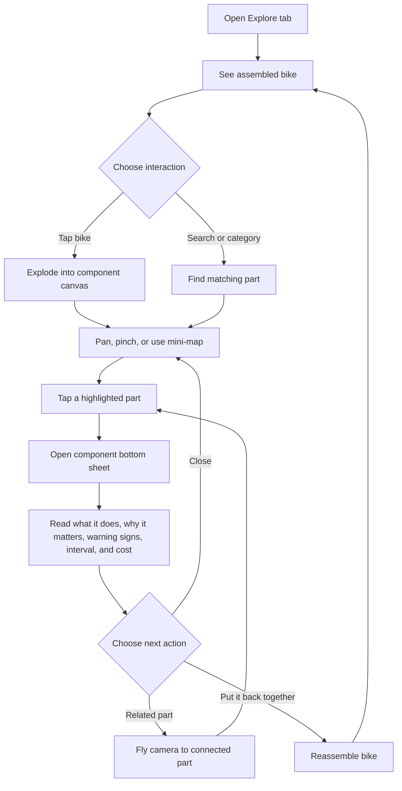
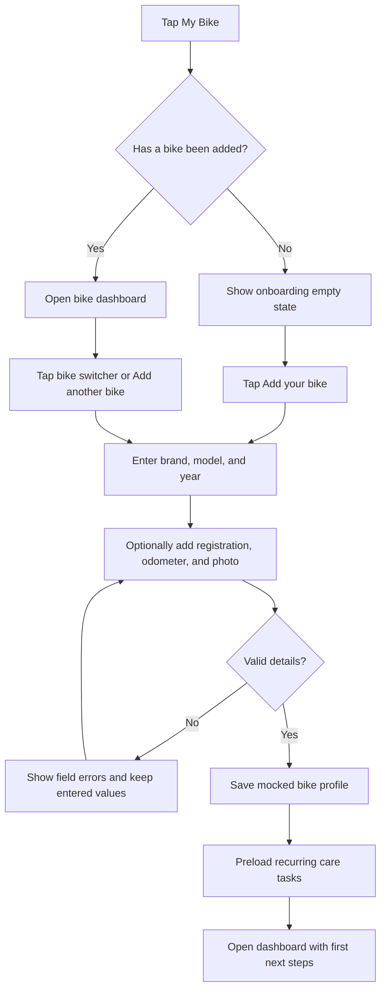
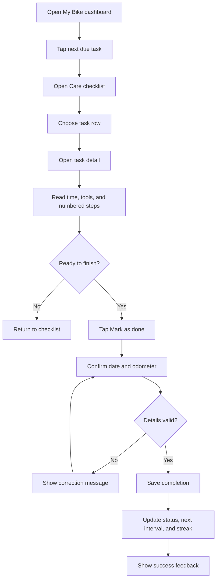
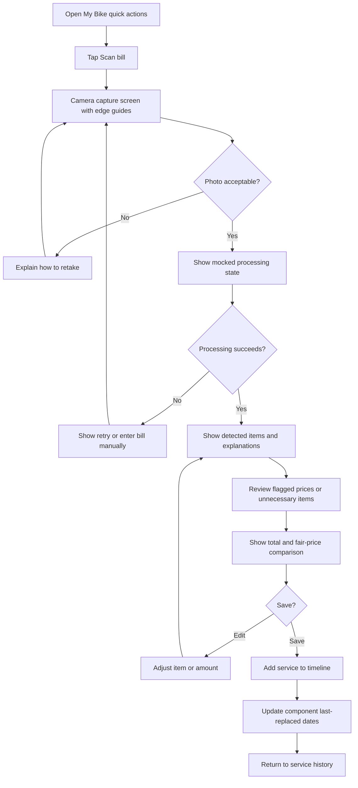
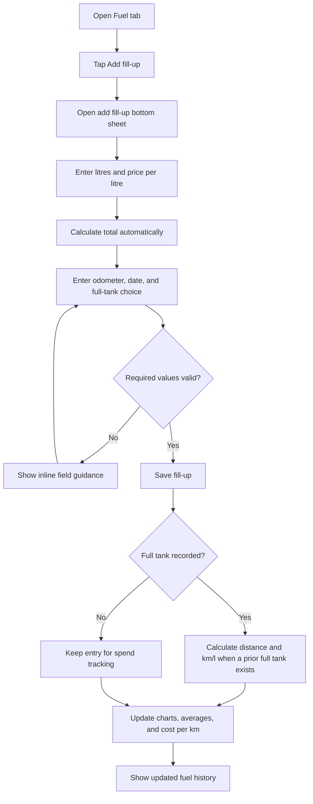

# BikeBuddy Product Plan

## 1. Product direction

BikeBuddy helps a first-time rider understand how a bike works and look after it
without needing a mechanic's vocabulary. The product should feel visual,
friendly, and useful in short moments: learning about one part, checking what
needs doing next, or recording something that just happened.

Product principles:

- Explain every technical word in plain language, using a familiar analogy when
  it helps.
- Show the bike and the next useful action before showing long explanations.
- Keep primary actions reachable with one hand and make touch targets at least
  48px.
- Treat loading, empty, error, and success states as part of every screen.
- Keep all current data mocked behind services so a backend can replace it later.
- Support light and dark themes, readable text scaling, and reduced motion.

## 2. User personas

### 2.1 New rider: Asha

**Profile:** Asha recently bought her first motorcycle and is unsure which
parts are important or what a mechanic is talking about.

**Goals**

- Learn what each visible bike part does.
- Know which care tasks are safe to do herself.
- Understand a service bill before paying.
- Build confidence without feeling judged for not knowing bike terms.

**Pain points**

- Technical names and diagrams feel intimidating.
- She cannot tell whether a warning sign is urgent.
- She worries that a service centre may recommend work she does not need.
- She does not yet have a maintenance routine or reliable history.

**Most valuable moments:** Explorer part sheet, task instructions, bill
explanations, and friendly empty states during onboarding.

### 2.2 Weekend enthusiast: Ravi

**Profile:** Ravi rides his motorcycle on weekends, enjoys learning how it is
built, and likes improving its setup.

**Goals**

- Explore connected components in detail.
- Keep a clean record of care, services, fuel, and modifications.
- Compare modification benefits, cost, difficulty, and legal or warranty
  concerns.
- Share ride knowledge with other enthusiasts.

**Pain points**

- Information is scattered across videos, forums, and paper receipts.
- He forgets irregular tasks between rides.
- Modification advice often leaves out warranty or legal trade-offs.
- Existing maintenance apps feel like spreadsheets rather than bike tools.

**Most valuable moments:** Exploded explorer canvas, care streaks, service
timeline, modification wishlist, and community groups.

### 2.3 Daily commuter: Meera

**Profile:** Meera depends on her bike every day and wants quick answers that
prevent breakdowns and control running costs.

**Goals**

- See the next due task immediately.
- Log a fuel fill-up in a few seconds.
- Track mileage and cost per kilometre.
- Find an open fuel station while travelling.
- Get reminders without too many notifications.

**Pain points**

- A missed service can disrupt work and travel.
- Fuel entries are easy to forget, making mileage hard to trust.
- She has little time for long reading or complicated forms.
- Location, camera, and notification permissions can be confusing.

**Most valuable moments:** My Bike dashboard, quick-action FAB, fuel sheet,
nearby stations, and configurable reminders.

## 3. Core user flows

The diagrams describe the intended happy path. Every screen also needs loading,
empty, error, and retry behaviour; permission denial must have a useful
fallback.

### 3.1 Exploring a part



### 3.2 Adding a bike



### 3.3 Completing a care task



### 3.4 Scanning a service bill



### 3.5 Logging fuel



## 4. Full screen inventory

| Screen name | Tab | Purpose | Key components | Data needed |
|---|---|---|---|---|
| Explore: assembled bike | Explore | Introduce the interactive bike and invite exploration | Header, motorcycle/bicycle toggle, layered SVG bike, tap hint, tab bar | Selected bike type, artwork layers, component catalogue |
| Explore: dissected canvas | Explore | Let a rider find and inspect parts spatially | Search, category chips, gesture canvas, exploded SVG parts, relation lines, mini-map, reassemble button | Component positions, SVG layer IDs, categories, related IDs |
| Component detail sheet | Explore | Explain one part and its care needs | Illustration, analogy, explanation sections, warning list, interval chip, cost badge, related-part chips | Component record, bike type, related components |
| My Bike onboarding | My Bike | Create the first bike profile | Brand/model/year fields, optional registration, odometer, photo picker, save button | Bike brands/models, validation rules, optional image URI |
| My Bike dashboard | My Bike | Give a fast health and maintenance summary | Bike photo, bike switcher, odometer, health ring, next due, last service, fuel average, FAB speed-dial | Bike profiles, health score, care tasks, service history, fuel summaries |
| Bike switcher | My Bike | Change the active bike or start another profile | Swipeable bike cards, page dots, add-bike action | Bike profiles and active bike ID |
| Care checklist | My Bike | Show recurring care work and its urgency | Streak card, task rows, status chips, swipe-to-done action, custom-task button | Care tasks, intervals by days/km, last completed values, streak |
| Task detail | My Bike | Teach a rider how to complete a task safely | Estimated time, tools, numbered steps, illustrations, reminder row, mark-done button | Task instructions, tools, completion record, reminder settings |
| Add or edit custom task | My Bike | Add care work not in the preloaded list | Name, interval by days/km, reminder controls, save/cancel actions | Custom task record, interval and notification preferences |
| Service history | My Bike | Show past work and next service timing | Next-service card, progress bar, bell toggle, timeline, scan-bill button | Service entries, odometer, dates, centre, costs, changed parts |
| Bill capture | My Bike | Capture a readable service receipt | Camera preview, edge guides, capture/retake controls, permission fallback | Camera permission state, captured image URI |
| Bill processing | My Bike | Explain that the receipt is being read | Processing animation, progress message, cancel/retry actions | Mock OCR job state and captured image |
| Bill results | My Bike | Help a rider review the mocked bill analysis | Thumbnail, line-item list, explanation text, price badges, reasons, totals, fair-price range, save button | OCR result, price comparison, flagged reasons, image URI |
| Fuel overview | Fuel | Track mileage and running cost over time | Stat cards, mileage line chart, monthly-spend bars, history list, add button | Fill-ups, calculated km/l, monthly spend, cost per km |
| Add or edit fill-up sheet | Fuel | Record one fuel purchase quickly | Litres, price/litre, auto total, odometer, date, full-tank toggle, validation | Fill-up draft, active bike odometer, previous full-tank entry |
| Fuel entry history | Fuel | Review, edit, or delete fill-ups | Swipe actions, dates, station/amount details, delete confirmation | Fill-up records and derived statistics |
| Nearby stations | More > Stations | Find fuel nearby and choose an open station | Map/list toggle, map pins, draggable list sheet, station cards, filter chips, navigate button | Mock station locations, hours, open state, fuel types, map permission |
| Community feed | Community | Browse useful rider posts and discussions | Feed cards, avatar, photo, likes/comments, top section tabs, new-post FAB | Mock posts, current user, reactions, comments |
| Community groups | Community | Browse discussions by brand or city | Group list, membership state, search/filter controls | Mock groups, rider memberships |
| Community events | Community | Find or view ride events | Event cards, date/location, join action, event detail | Mock events, attendance state |
| Community Q&A | Community | Ask and answer practical bike questions | Question list, answer counts, ask-question action, detail view | Mock questions, answers, author profiles |
| New post | Community | Share a text or photo post | Text field, photo picker, group selector, publish action | Draft post, optional image URI, group ID |
| Modifications | More > Modifications | Compare useful bike changes | “For my bike” / “Popular for all” tabs, mod cards, filters, wishlist button | Modification catalogue, active bike compatibility, wishlist |
| Modification detail | More > Modifications | Explain benefit and trade-offs before saving | Before/after imagery, benefit, cost, difficulty, legal/warranty note, wishlist | Modification record, compatibility, legal note |
| More hub | More | Provide access to secondary features and settings | Stations, Modifications, Settings rows, profile/preferences summary | Feature availability, user preferences |
| Settings and reminders | More | Control theme, notifications, units, and permissions | Theme toggle, reminder preferences, unit choice, permission links | User preferences, notification permission state |

Each screen should also define explicit loading, empty, error, and retry
states. Bottom sheets and camera/permission views are included in the
inventory because they have independent interaction and accessibility needs.

## 5. Navigation map

### Root navigation

```text
Root stack
├── Main tabs
│   ├── Explore tab
│   │   ├── Assembled bike screen
│   │   └── Dissected canvas screen
│   │       └── Component detail bottom sheet
│   ├── My Bike tab
│   │   ├── Onboarding stack (when no bike exists)
│   │   │   └── Add bike screen
│   │   └── Bike stack
│   │       ├── Dashboard
│   │       ├── Care checklist
│   │       │   ├── Task detail
│   │       │   └── Add/edit custom task
│   │       ├── Service history
│   │       ├── Bill capture
│   │       ├── Bill processing
│   │       └── Bill results
│   ├── Fuel tab
│   │   └── Fuel overview
│   │       └── Add/edit fill-up bottom sheet
│   ├── Community tab
│   │   ├── Feed
│   │   ├── Groups
│   │   ├── Events
│   │   └── Q&A
│   │       └── New post / question modal
│   └── More tab
│       ├── More hub
│       ├── Nearby stations
│       ├── Modifications
│       │   └── Modification detail
│       └── Settings and reminders
└── Global overlays
    ├── My Bike FAB speed-dial
    │   ├── Add fuel
    │   ├── Mark chore done
    │   ├── Add service
    │   └── Scan bill
    ├── Confirmation dialogs
    ├── Toasts and success feedback
    └── Permission education dialogs
```

### Navigation decisions

- The five bottom tabs remain visible for the primary top-level destinations.
- Explore uses a stack-like transition from the assembled view to the canvas,
  while component information is a draggable bottom sheet so the bike remains
  visible behind it.
- My Bike owns the active bike ID. All care, service, and fuel screens read and
  write against that active bike.
- The floating plus button is a speed-dial, not a separate tab. Its actions
  open the appropriate screen or sheet and preserve the active bike.
- Add fill-up, component details, and short confirmations use bottom sheets.
  Multi-step work such as camera capture and bill results uses full screens so
  the user has space to review and recover from errors.
- Destructive actions, such as deleting a fuel entry, require a confirmation
  dialog and must not be hidden behind a swipe alone.

## 6. Risks and assumptions

### Explorer gestures and interaction

- **Risk:** Pan, pinch, double-tap reset, part selection, and scrolling category
  chips can compete for touch ownership.
  **Mitigation:** define gesture priority by region, keep controls outside the
  canvas, use a clear reset affordance, and test one-handed use on both
  platforms.
- **Assumption:** the initial SVG artwork supplies stable layer IDs and
  component positions for both motorcycle and bicycle modes.
- **Risk:** a large exploded scene can become hard to understand on a small
  phone.
  **Mitigation:** preserve a mini-map, highlight the selected part and its
  relations, and let search/category selection fly the camera to a known
  position.

### SVG and animation performance

- **Risk:** many SVG paths, relation lines, glows, and 700ms explode/reassemble
  motion may drop frames on lower-end Android devices.
  **Mitigation:** keep artwork layered and reusable, avoid unnecessary path
  duplication, animate transforms rather than geometry where possible, and
  measure on a physical low-end device.
- **Assumption:** reduced-motion preference replaces spring/explode motion with
  short fades and preserves the same state changes.
- **Risk:** a component sheet can obscure the selected part.
  **Mitigation:** dim the canvas, keep the selected part visible where possible,
  and offer a related-part action that closes or repositions the sheet.

### Data, calculations, and services

- **Assumption:** all catalogue, care, service, fuel, station, community, and
  modification data is local mock data behind typed services.
- **Risk:** mileage calculations are misleading when there are no two
  full-tank entries or when odometer values are missing.
  **Mitigation:** label incomplete statistics clearly and never show a
  success-shaped zero as a real average.
- **Risk:** OCR and fair-price comparisons can look authoritative despite being
  mocked.
  **Mitigation:** label the feature as an estimate/mock result in development
  data and design the service boundary so a real provider can return
  confidence and explanation fields later.

### Notifications, camera, and location

- **Risk:** notifications are denied, delayed, or disabled at the system level.
  **Mitigation:** show reminder state in the app, explain the benefit before
  requesting permission, and provide a settings shortcut without blocking
  maintenance tracking.
- **Risk:** camera permission or poor lighting prevents a useful bill scan.
  **Mitigation:** provide edge guides, retake guidance, a clear permission
  fallback, and a manual-entry path.
- **Risk:** location permission is unavailable for nearby stations.
  **Mitigation:** allow a mocked/default area or manual location selection and
  keep the list usable without a live map.

### Scope and product assumptions

- Authentication, payments, real backend sync, real OCR, and production
  recommendations are out of scope for this phase.
- A rider can have multiple bikes, but one bike is active for dashboard actions
  at a time.
- Registration is optional; brand, model, year, and a starting odometer are
  enough to create a usable profile.
- Costs use Low / Medium / High for component education and Indian rupees
  (`₹`) for service and fuel amounts unless the product requirements change.
- Community content is mocked and should be designed so reporting, moderation,
  and privacy controls can be added before real users are introduced.

## 7. Suggested next step

Run `/step2-design-system` to turn this plan into the shared token, component,
motion, and accessibility foundation before implementing screens.
